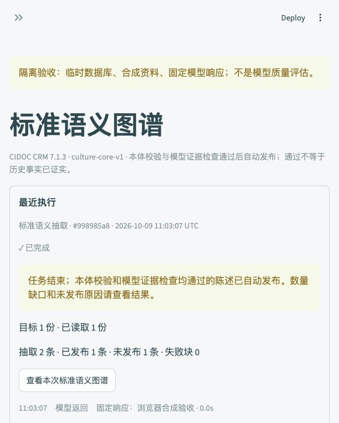
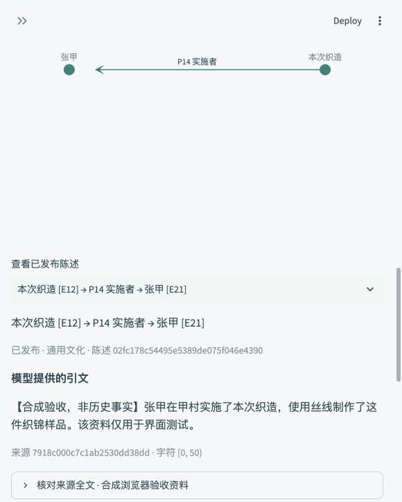

# Atlas 主工作台本体 Agent Demo

## 使用

使用原有 `./start.sh` 启动或重启 Atlas，打开资料工作台。
“自动构建本体图谱”默认主题为宋朝文化、数量为 3、领域为通用文化。
确认模型设置已连接，点击“一键搜集并构建本体图谱”。
任务在后台运行，切换页面继续执行；最近执行记录提供本次批次链接。
标准语义图谱页面可查看原文、模型证据判断、未发布原因和导出。
批次选项显示“研究主题（手动构建为首份资料标题）· 北京时间 · 资料数量 · 短 ID”，选中后显示全部来源标题、模型、状态和完整 ID。旧自动批次尽可能从原任务记录读取主题，缺少记录时显示资料标题。

## 处理与发布规则

- 最多 3 个检索词，每词最多 10 个候选链接，串行读取，URL 和正文去重。
- 每份使用前 9,000 字符，保留截断标记；数量不足如实报告，不使用搜索摘要构图。
- 复用 CIDOC CRM 7.1.3 的 13 类、10 属性。抽取提示词版本为 `culture-extraction-v2`，证据检查为 `culture-evidence-v1`。
- 模型可输出 P14 等属性代码，解析时转换为标准 URI；完整 URI 仍受支持。
- 仅本体校验通过且证据检查明确 supported 的陈述发布。unsupported/uncertain 保留为未发布，不自动重新判断。
- 每个有合格候选的文本块额外调用一次批量证据检查。检查协议错误或调用失败保留候选，将该块标记失败；显式重试复用已抽取结果，只重新检查。
- 检查记录关联陈述、实体标签与类型、原文块哈希、模型和版本；维护、重启及手动批准入口都不能绕过检查。
- 历史已发布知识保留原发布依据；历史未发布候选需重新抽取，不能通过“重新校验并自动发布”补造检查结果。
- 抽取和发布不修改原有 LightRAG 文档状态。数据库结构仍为版本 1，新增记录使用现有 JSON 字段。

## 自动测试与浏览器验收（2026-10-09）

全套测试覆盖采集失败跳过、正文截断、去重、零资料不建批次、关系代码映射、本体继承与方向、证据不支持、非法检查响应、缺失/重复/未知标识、超时重试、历史数据、维护发布边界与导出。
验证结果：114 项普通测试通过；另 1 项 HTTP 协议测试在允许本机临时监听端口后通过，合计 115 项。仅有现有 Qdrant 本地索引提示与 RDFLib 弃用提示。
主应用 AppTest 使用真实 Engine、临时资料库、固定搜索/模型响应，验证新入口、后台任务互斥、页面切换、批次筛选及导出。

浏览器运行 `scripts/semantic_demo.py`，复用主项目导航、资料工作台和标准语义图谱页面。所有输入为合成资料，数据为临时数据库。
实际操作：输入 1 份 → 一键启动 → 切换标准语义图谱 → 按本次批次查看 → 下载 Turtle。
结果：抽取 2 条，正确的 P14 发布，人物作为 P7 主体的错误关系被阻止；下载的 Turtle 重新解析为 36 个 RDF 三元组。




## 真实模型小规模验证（2026-10-09）

通过 `scripts/evaluate_semantic_auto.py`，读取当前配置的 DeepSeek `deepseek-flash`，主题为“宋朝文化 宋代 点茶 茶具”，目标为 1 份。
所有采集、语义保存和自动发布均在临时数据库完成，没有写入用户资料库或图谱。

检索词规划成功生成三个词。首个检索失败，后续检索中知乎及百度百科正文读取失败，系统继续取得 [搜狐点茶文章](https://www.sohu.com/a/423580524_100270281) 的正文。
最终读取 1 份，抽取 2 条，证据检查均为 supported，自动发布 2 条，失败块 0。

| 主语及类型 | 关系方向 | 宾语及类型 | 检查结果 |
|---|---|---|---|
| 《清异录》 E31 | P70 记载 → | 鹧鸪斑盏 E55 | 原文引用该文献记载鹧鸪斑盏 |
| 《大观茶论-盏》 E31 | P70 记载 → | 盏形制要求 E29 | 原文引用该文献关于盏底深浅宽窄的要求 |

检查结论：关系均为文献指向被记载内容，本地类型约束通过；引文可以在网页正文中定位。通识点茶介绍没有被改写成一次具体活动。
“盏形制要求”映射为 E29 是模型的建模判断，本次未做独立专家复核；来源为现代二手文章，不能据此声称古籍原文已得到独立校勘。
这一次验证说明真实流程可运行，不构成模型历史知识准确率评估。完整临时报告位于 `/tmp/atlas-auto-live-report.json`，不包含 API Key。

复现：

```sh
NO_PROXY=127.0.0.1,localhost .venv/bin/python -m pytest -q
.venv/bin/python -m streamlit run scripts/semantic_demo.py --server.address 127.0.0.1 --server.port 8503
.venv/bin/python scripts/evaluate_semantic_auto.py \
  --config data/workbench/silk_culture_demo/llm-settings.json \
  --output /tmp/atlas-auto-live-report.json
```

## 简单 demo 的边界

本期不增加独立相关性评分、跨文档实体融合、2000 条资源调度或图谱问答；普通同名实体保留分离。
SHACL 检查形式与类型，模型检查原文支持程度，两者都不保证资料可靠性或最终历史事实正确。
