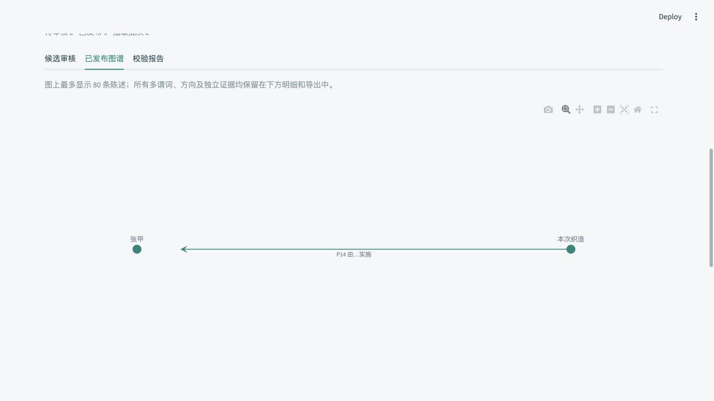

# 语义图谱实施验收记录

注：下文记录初版人工审核流程的历史验收。2026-10-06 已按用户要求改为校验通过后自动发布，当前行为以 semantic-graph.md 为准。

日期：2026-10-05。所有抽取与发布验收使用隔离临时目录，合成资料未写入用户工作区。当前模型连接只用于明确标注为合成的三份短文，不发送用户资料库正文。

## 自动验证

最终完整回归：**92 passed**；依赖一致性检查通过。

测试覆盖协议解析、白名单、完整相关祖先链、SHACL、原文字符定位和全文哈希；还覆盖单实体对多谓词、双向陈述、独立来源证据、同名实体隔离、受控词表复用、未审禁发、批量事务、幂等审核、撤回历史、新批次审核隔离、版本变化、超时、非法 JSON、部分失败、重启中断和重试。

Turtle 与 JSON-LD 重新解析后检查三元组、实体 URI、RDF Statement 及证据/审核链接。真实 Engine 集成测试确认已经 processed 的资料可进行语义抽取，原资料状态不变、现有任务锁有效。Streamlit AppTest 验证确认框、批准和撤回；原采集、LightRAG 构建、三类向量、检索和回放测试同时保留。

现有依赖提示两条非失败警告：本地 Qdrant 不使用 payload index；RDFLib 的 JSON-LD 解析器使用已弃用的 ConjunctiveGraph。HTTP 回归需绕过本机系统代理对 127.0.0.1 的错误转发。

## 真实模型小规模评估

模型：当前配置的 `deepseek-flash`，使用现有 Chat Completions 兼容连接。调用成功本身不代表知识正确；评估程序不调用批准或发布接口。

| 领域 | 最终抽取 | 校验通过 | 类型与方向工程检查 | 证据检查 |
| --- | ---: | ---: | --- | --- |
| 丝绸 | 7 条 | 7 条 | E12、E21、E53、E22、E57、E55、E31 相关关系符合预期；包含 P7 | 7 条引文可定位，结合全文支持 |
| 茶 | 4 条 | 4 条 | 一次 E7 制茶活动；P14/P32/P2/P70 方向符合预期 | 4 条引文可定位，结合全文支持 |
| 黄酒 | 6 条 | 6 条 | 两位同名人物、两次活动均保留独立 ID | 6 条引文可定位，结合全文支持 |

三份材料均未补造日期；茶、黄酒未补造未知活动地点。最终输出将概念上下位关系保留为待建模说明。部分引文是短语，只有展开来源全文才能核实其主语，因此 UI 同时提供保存的全文快照。

这是 Codex 对合成原文和输出逐条进行的工程检查，**不是独立人类专家审核，也不是真实文献准确率报告**。30 条合成基准带有预期判断，但仍需领域人员独立核对。完整最终输出、配置哈希及检查说明见 [评估 JSON](semantic-live-evaluation.json)。

调试期间曾观察到 P2 被用于概念上下位分类，以及 deferred 被返回为对象数组。前者促使增加明确的建模规则，后者由严格协议拒绝；补充字符串数组规则后，最终三份样例均成功。没有在产品流程中添加额外的自动修复模型调用。

## 浏览器验收

使用 `scripts/semantic_demo.py`：真实 Engine、真实临时 SQLite/Qdrant，模型返回固定合成响应。浏览器执行：选择资料 → 独立抽取 → 阅读 P7 错误候选及 SHACL 报告 → 尝试批准被拦截 → 驳回 → 确认 P14 正确候选的证据和类型 → 批准 → 查看从“本次织造”指向“张甲”的箭头 → 下载 Turtle → 撤回。

下载文件经 RDFLib 读取，只有批准的 P14，不含错误 P7。撤回后页面显示已发布 0，历史记录保留。另以 AppTest 对最终页面代码验证批准和撤回。验收服务与浏览器已关闭。

